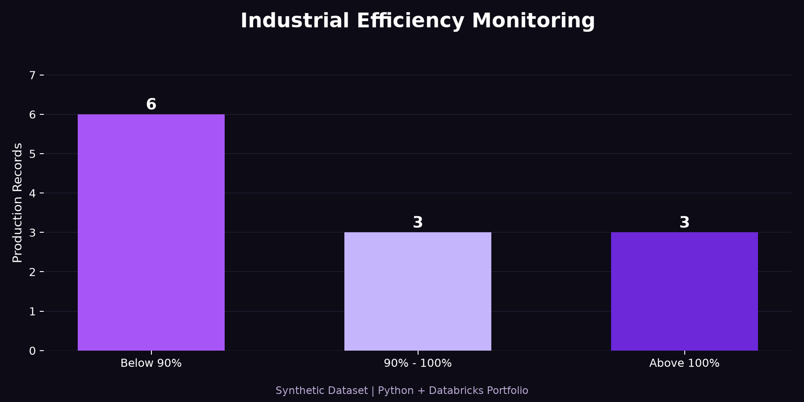

<div align="center">

#  Industrial Data Monitoring


[](https://github.com/andressaldanha/industrial-data-monitoring/actions/workflows/python-tests.yml)
  

### Industrial Data Analytics | Python | Databricks

**Transforming industrial production data into actionable insights.**


</div>

---

## 📌 Project Overview

This project focuses on monitoring industrial production records to identify efficiency deviations and potential inconsistencies in downtime reporting.

It uses Python and Databricks to process production data through a structured data pipeline.

## 🎯 Objectives

- Identify production records with efficiency below 90%.
- Detect records with efficiency above 100%.
- Analyze standard and actual operation times.
- Identify potential missing downtime records.
- Improve data quality and analytical visibility.

## 🏗️ Data Architecture

### Bronze Layer
Raw data ingestion and initial preprocessing.

### Silver Layer
Data cleaning, standardization, and validation.

## 📊 Business Rules

| Indicator | Rule |
|---|---|
| Low efficiency | Below 90% |
| Expected range | 90% to 100% |
| Above expected | Greater than 100% |
| Excess time | MAX(Actual Time - Standard Time, 0) |
| Downtime difference | (Actual Time - Standard Time) - Reported Downtime |

## 🛠️ Technologies

- Python
- Pandas
- Databricks
- Excel / OpenPyXL
- Data Engineering

## 🔒 Data Privacy

This public portfolio project will use synthetic data. No confidential company information or employee records will be published.


## 📊 Processing Results

The Bronze and Silver layers were tested using
12 synthetic industrial production records.

## 📈 Efficiency Chart

The chart below shows the efficiency classification
of the 12 synthetic production records used in this project.

<p align="center">
  
</p>

### Efficiency Monitoring

| Classification | Records |
|---|---:|
| Below 90% | 6 |
| Within expected range | 3 |
| Above 100% | 3 |
| **Total** | **12** |

### Downtime Validation

The Silver layer identified **3 records with potential missing downtime**.

These records are flagged for investigation based on
differences between standard time, actual operation time,
and reported downtime.

### Data Pipeline

Excel Dataset → Bronze Layer → Silver Layer

**Bronze:** Data ingestion, column validation and type conversion.

**Silver:** Efficiency classification, excess time calculation
and downtime consistency checks.

> All data used in this public project is synthetic.
> The results do not represent real company operations.


## 🚧 Project Status

**In development**

Upcoming steps include publishing the Bronze and Silver processing code with synthetic examples and documenting the validation results.


## 🚀 How to Run

### 1. Clone the repository

```bash
git clone https://github.com/andressaldanha/industrial-data-monitoring.git
cd industrial-data-monitoring
```

### 2. Create a virtual environment

```bash
python -m venv .venv
```

Activate it:

**Linux / macOS**
```bash
source .venv/bin/activate
```

**Windows PowerShell**
```powershell
.venv\Scripts\Activate.ps1
```

### 3. Install dependencies

```bash
python -m pip install -r requirements.txt
```

### 4. Execute the data pipeline

Run the Bronze layer:

```bash
python notebooks/bronze.py
```

Run the Silver layer:

```bash
python notebooks/silver.py
```

### 5. Generate the efficiency chart

```bash
python scripts/generate_chart.py
```

The generated chart is saved at:

`assets/efficiency_chart.png`

### 6. Run automated tests

```bash
python -m pytest tests/ -v
```

The project includes automated tests for data ingestion,
column validation, efficiency classification and downtime rules.

## 📁 Project Structure

```text
industrial-data-monitoring/
├── .github/workflows/
│   └── python-tests.yml
├── .vscode/
│   └── settings.json
├── assets/
│   └── efficiency_chart.png
├── data/
│   └── production_sample.xlsx
├── notebooks/
│   ├── bronze.py
│   └── silver.py
├── scripts/
│   └── generate_chart.py
├── tests/
│   ├── test_bronze.py
│   └── test_silver.py
├── .gitignore
├── README.md
└── requirements.txt
```

## 🔐 Data Privacy

All production records in this public repository are synthetic.

The project demonstrates industrial data monitoring concepts
without exposing confidential company information.

## ✅ Automated Quality Checks

The project uses Pytest and GitHub Actions to validate
the processing logic automatically.

Current test suite: **9 automated tests**.

## 🔮 Future Improvements

- Additional synthetic datasets
- Historical trend analysis
- More advanced analytical dashboards
- Enhanced data quality monitoring

---

<div align="center">

Developed by **Andressa Saldanha** 💜

</div>

